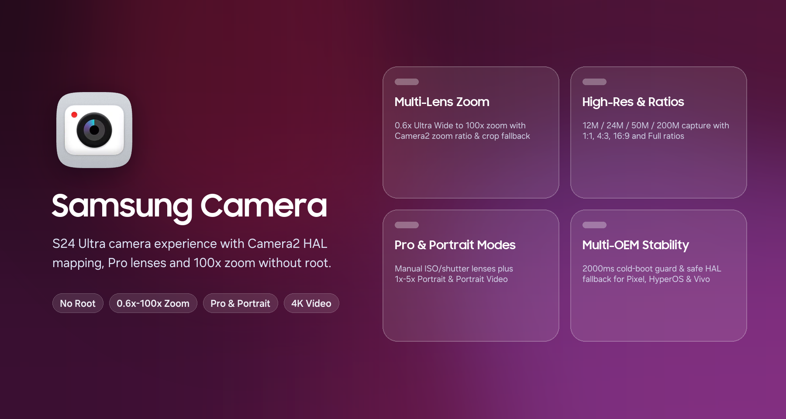

<div align="center">


<h1>
  <picture>
    <source media="(prefers-color-scheme: dark)" srcset="assets/badges/title-dark.svg" />
    
  </picture>
</h1>

<a href="#overview"></a>
<a href="#compatibility-and-limits"></a>
<a href="#setup-and-installation"></a>
<a href="#how-every-feature-works"></a>
<a href="https://github.com/smartworldarafath/Samsung_Camera/releases/tag/v1.22"></a>

</div>

<br />



<br />

## Overview

**Samsung Camera** (`v1.22 Universal Beta`) brings the **Samsung Galaxy S24 Ultra One UI Camera** interface and shooting modes to **non-Samsung Android devices** (**Xiaomi HyperOS**, **Google Pixel**, **Vivo OriginOS**, **Oppo ColorOS**, **OnePlus**, **Realme**, **Nubia**, and AOSP) without requiring root.

Normally locked tightly to Samsung sensor IDs, Exynos/Galaxy camera extensions, and proprietary boot-time feature checks, this port dynamically queries standard Android **Camera2** characteristics, clamps picture stream dimensions safely per OEM HAL, and guards cold-boot loading timeouts across both flagship and midrange SoCs.

---

## Highlights

<table>
<tr>
<td width="33%" valign="top">

### Dynamic Lens & Zoom Mapping
- `0.6x` Ultra Wide, `1x` Main, and Telephoto sensor ID discovery via Camera2
- Smooth optical/digital zoom (`1x–10x`) plus cropped high-magnification (`10x–100x`)
- Aspect ratios (`1:1`, `4:3`, `16:9`, `Full`) and high-resolution (`12M/24M/50M/200M`) toggles

</td>
<td width="33%" valign="top">

### Full Shooting Mode Suite
- `Photo`, `Portrait`, `Portrait Video` (`1x/2x/3x/5x`), and `Video` (`HD/FHD/UHD 4K`)
- `Pro` & `Pro Video` manual lens switcher (`UW/W/T/ST`) with resolution & FPS menus
- `Night`, `Food`, `Slow Motion`, `Hyperlapse`, and `Panorama` capture modes

</td>
<td width="33%" valign="top">

### Multi-OEM Crash Guards
- Extended `2000ms` cold-boot feature latch prevents timeouts on midrange chipsets
- Non-fatal HAL capability guards eliminate crash loops across Android 12–16+
- Startup initialization guards protect against missing Samsung companion packages

</td>
</tr>
</table>

---

## Status Legend

| Badge | Meaning |
| :--- | :--- |
|  | Works reliably across supported non-Samsung Camera2 HAL devices without root. |
|  | Behavior depends on your device vendor's Camera2 HAL exposure or signature rules. |
|  | Depends on closed Samsung multi-camera HAL pipelines or external Galaxy packages. |

---

## How Every Feature Works & Device Verification

| Mode / Feature | Status | How It Works on Non-Samsung Android |
| :--- | :---: | :--- |
| **Photo (`0.6x–100x` Zoom & `12M–200M`)** |  | Maps focal lengths dynamically from `CameraManager`, drives Camera2 `CONTROL_ZOOM_RATIO` up to `10x`, and center-crops saved JPEGs up to `100x` with safe single-stream capture sizing. |
| **Portrait & Portrait Video** |  | Exposes `1x/2x/3x/5x` focal presets, hides the zoom bar cleanly when toggling blur strength, and falls back to safe front/rear IDs for photo and `.mp4` video capture. |
| **Video (`HD` / `FHD` / `UHD 4K`)** |  | Configures standard Camera2 video recording profiles (`24/30/60fps` depending on OEM sensor exposure) with clean audio/video muxing. |
| **Pro & Pro Video (`UW/W/T/ST`)** |  | Assigns valid focal zoom presets per lens and populates resolution/frame-rate selectors safely when your OEM exposes Camera2 manual controls. |
| **Night, Food, Slow Motion & Hyperlapse** |  | Routes frames through Camera2 single-stream capture graphs with high-speed batch fallback handling on MediaTek/Snapdragon chipsets. |

---

## Compatibility and Limits

| Feature / Scenario | Status | Technical Reason |
| :--- | :---: | :--- |
| **Dual Recording** |  | Simultaneous multi-camera hardware streams require Galaxy HAL concurrent camera vendor tags; unavailable OEM configurations fall back safely with a toast message instead of crashing. |
| **Bixby Vision & Companion Links** |  | External system camera shortcuts (Bixby Vision, Samsung Gallery deep links) target Galaxy companion packages not installed on third-party ROMs. |
| **8K Video / Full 200MP Sensor Readout** |  | Actual capture resolution and `8K`/`240fps` stream availability depend strictly on whether your phone's OEM Camera2 HAL exposes those raw streams to third-party apps. |
| **Unrooted Samsung Galaxy Devices** |  | Stock Galaxy ROMs sign pre-installed Samsung Camera with Samsung's private platform key; installing a community-signed APK over the system package fails with a signature conflict (`INSTALL_FAILED_UPDATE_INCOMPATIBLE`). |

---

## Setup and Installation

1. Download **`Samsung_Camera_OneUI_8.5_Universal_Beta_v1.22.apk`** (`~67.9 MB`) from the [Latest Release](https://github.com/smartworldarafath/Samsung_Camera/releases/tag/v1.22).
2. Install directly on any non-Samsung Android phone (**no root required**). Grant Camera, Microphone, and Storage permissions on first open.
3. To rebuild locally from the workspace after modifying smali or resources:
   ```bash
   python scripts/build_and_install.py --install
   ```
   Requires `apktool`, Android SDK `build-tools` (`zipalign`, `apksigner`), and `adb` on `PATH` (never commit custom keystores or `.env` secrets).
